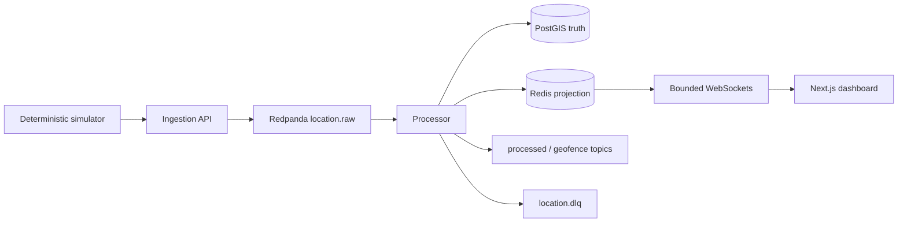

# Vector — Real-Time Location Event Platform

An executable distributed-systems portfolio story: simulated devices enter through a
bounded Fastify API, Redpanda buffers at-least-once delivery, an idempotent processor
maintains PostGIS history/current state, Redis accelerates/fans out live state, and a
MapLibre dashboard resynchronizes through REST after WebSocket reconnects.

## Coding-agent workflow

Codex and Claude Code share one repository contract: Codex discovers
[`AGENTS.md`](AGENTS.md), while [`CLAUDE.md`](CLAUDE.md) imports it and provides
`/session-start` and `/session-wrap` conveniences. Before changes, read the canonical
[requirements](docs/requirements.md), [design](docs/design.md),
[engineering workflow](docs/engineering-workflow.md), and current [handoff](HANDOFF.md).
Do not run a proposed destructive failure/load experiment without explicit approval.



## Run

```bash
corepack enable && pnpm install
cp .env.example .env
# set NEXT_PUBLIC_CARTO_API_KEY in .env (free key: https://carto.com/basemaps/apikey)
docker compose up --build
```

The dark basemap uses CARTO raster tiles, which have required a free key since
2026-09-25. Without `NEXT_PUBLIC_CARTO_API_KEY` the map shows gray "API KEY REQUIRED"
tiles. The key is baked into the web image at build time, so rebuild after changing it
(`docker compose up -d --build web`). Map data © OpenStreetMap contributors © CARTO.

Dashboard: `http://localhost:3100`; OpenAPI: `http://localhost:4100/docs`.
Producer calls need `x-api-key: local-demo-key`. The 202 response acknowledges broker
acceptance, not downstream completion.

The default Compose stack connects to LA Metro's official bus vehicle-position
WebSocket, normalizes each GTFS-realtime-shaped message, batches it through the public
ingestion contract, and displays the processed positions on a labeled, clickable map.
Bus-line, trip, direction, and provider-vehicle metadata remain attached to each current
state. Selecting a bus retrieves its official directional stop pattern and route overview,
draws the line, and labels the popup with direction and destination (for example,
`Metro 487 · Eastbound to Sierra Madre Villa Station`). The map follows a selected bus
only when it leaves the user's current viewport; Home restores the Los Angeles default
extent. Provider timestamps become per-vehicle sequence numbers and deterministic event
UUIDs make redelivery idempotent.
The deterministic simulator remains available as an explicit offline/failure-test source:

```bash
pnpm simulate -- --devices 1000 --hz 0.2 --duplicates 0.01 --late 0.02 --seed 42
```

## Guarantees

Delivery is **at least once**, not exactly once. `event_id` prevents duplicate history;
the `(sequence_number,event_time,event_id)` comparison prevents delayed events moving
current state backward; transition uniqueness makes replay safe. PostgreSQL is truth.
Redis loss removes live fanout/cache but durable processing continues. WebSocket clients
fetch REST truth then resubscribe after reconnect.

## Verify and demonstrate failure

```bash
pnpm lint && pnpm typecheck && pnpm test && pnpm build
k6 run load-tests/ingestion.js
docker compose stop redis                 # simulator continues; REST falls back to PG
docker compose start redis                # next update/read repopulates projection
pnpm dlq:list
pnpm dlq:replay -- --event-id <uuid>
```

Then force a processor restart immediately after a DB commit (debug breakpoint or SIGKILL
before offset commit): Redpanda redelivers and the primary-key insert classifies the event
as duplicate. Inspect processor metrics/logs and consumer lag with `rpk`. No representative
load result or screenshot is committed yet; do not present the configurable k6 threshold
as a measured achievement. The complete quality gate and documentation/evidence mapping
are defined in [`docs/engineering-workflow.md`](docs/engineering-workflow.md).

## Intentional scope

No real personal location data, identity platform, Kubernetes, magical exactly-once claim,
or unbounded retry/fanout. See the consistency, failure, privacy, and scaling documents.
